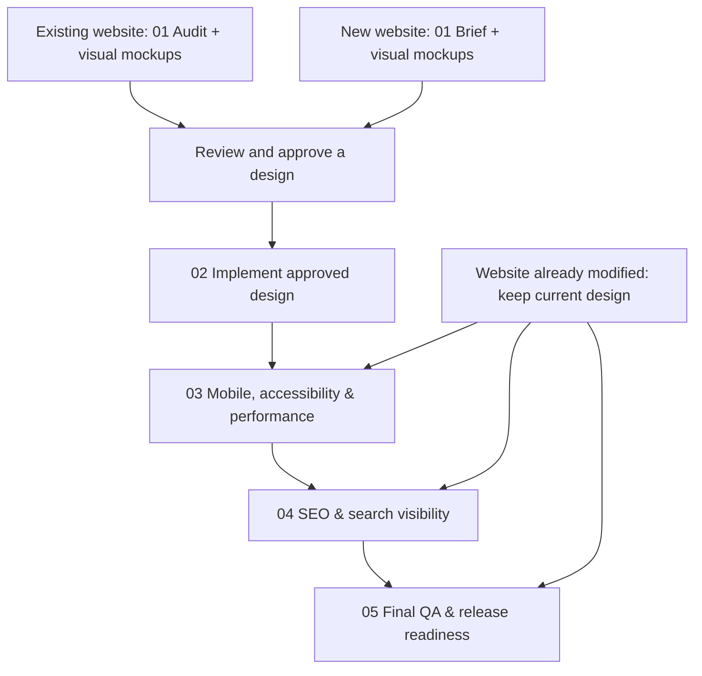

# Website Prompts

Reusable prompts for Codex to improve an **existing website** or build a **new website**, using the target repository's real source code and browser evidence.

Start with an interactive Design Studio, compare responsive mockups, approve a design, then implement and optimize it.

## Workflow

Choose the starting point that matches your project. Steps 2–5 are shared.



## Prompts

| Prompt | Purpose | Status |
| --- | --- | --- |
| [01 · Existing website](existing-website/01-audit-and-visual-design-studio.md) | Audit the current site and present issues, design alternatives, and responsive mockups in an interactive studio. | **Validated workflow*** |
| [01 · New website](new-website/01-brief-and-visual-design-studio.md) | Define the brief, page structure, and visual mockups for a website built from scratch. | Not validated |
| [02 · Implementation](shared/02-implement-approved-design.md) | Faithfully implement the approved mockups, or correct an implementation already started. | Not validated |
| [03 · Mobile, accessibility & performance](shared/03-mobile-accessibility-performance.md) | Review responsive layouts, accessibility, and performance; propose targeted fixes. | Not validated |
| [04 · SEO](shared/04-seo-and-search-visibility.md) | Review technical SEO, content, keywords, structured data, and search/AI visibility. | Not validated |
| [05 · Final QA](shared/05-final-qa-and-release-readiness.md) | Check functionality, visuals, regressions, accessibility, performance, and SEO; assess release readiness. | Not validated |

*The existing-site workflow was tested successfully as separate audit and visual-review prompts. This merged version has not yet been rerun.*

## Usage

Run one prompt at a time with access to the **target website repository**. This library holds instructions only; application code, `design-review/`, and `website-review/` belong in that target repository.

- **Full workflow:** Run the appropriate Prompt 01, review the mockups, approve a design, then continue through Prompts 02–05.
- **Approved mockups or partial implementation:** Start at Prompt 02.
- **Already happy with the design:** Run Prompts 03, 04, or 05 independently to improve or verify the current website.

Prompts 03–05 are independent: use `review` (default) for proposals, `implement-approved` for approved issue IDs, or `verify` to refresh evidence without code changes. Reuse the same visual board; Prompt 02 is not needed for these fixes. When running all three, keep 05 last and rerun it after subsequent fixes.

Example instruction in Codex (replace the target path):

```text
Read C:\GIT\AIPrompts\website\shared\03-mobile-accessibility-performance.md
and execute it in review mode on C:\GIT\MyWebsite. Inspect that repository's
real source code and browser rendering. Keep my current design and manual changes.
```
